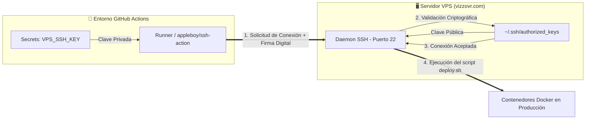
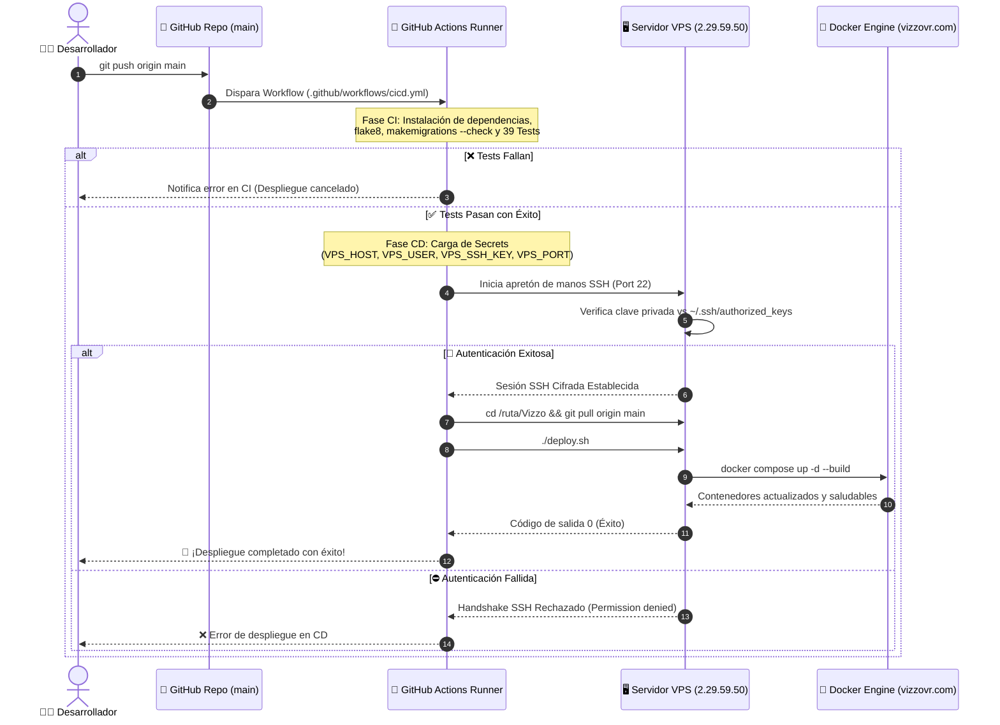

# 🚀 Comandos de Despliegue en Producción (vizzovr.com)

Ejecuta estos 3 comandos en la terminal de tu servidor Linux VPS cada vez que subas cambios al repositorio:

```bash
git pull
docker compose build --no-cache (opcional para reconstruir la imagen primero.)
docker compose up -d --build
```

---

### 💡 Notas Útiles

- **Ejecutar todo en un solo comando**:

  ```bash
  git pull && docker compose build && docker compose up -d
  ```

- **O bien usando el script ejecutable**:
  ```bash
  chmod +x deploy.sh
  ./deploy.sh
  ```

---

## 🤖 Despliegue Automático CI/CD (GitHub Actions)

El proyecto cuenta con un workflow de **CI/CD automatizado** en `.github/workflows/cicd.yml`. Cada vez que hagas `push` a la rama `main`:

1. **CI**: Se ejecutan automáticamente los **39 tests** de Django, validación de sintaxis (`flake8`) y comprobación de migraciones.
2. **CD**: Si los tests pasan correctamente, GitHub Actions se conecta por SSH a tu VPS y ejecuta `./deploy.sh` automáticamente.

### 🔑 Configuración de Secrets en GitHub:
En tu repositorio GitHub (**Settings -> Secrets and variables -> Actions**), añade los siguientes Secrets:

- `VPS_HOST`: Dirección IP o dominio de tu servidor VPS (ej. `2.29.59.50` o `vizzovr.com`).
- `VPS_USER`: Usuario SSH de tu servidor VPS (ej. `root` o tu usuario de despliegue).
- `VPS_SSH_KEY`: Clave **privada** SSH generada y autorizada en el VPS (`~/.ssh/authorized_keys`).
- `VPS_PORT`: Puerto SSH del servidor (por defecto `22`).

---

## 🔐 Flujo de Comunicación SSH en CI/CD

El proceso de despliegue automático utiliza criptografía asimétrica SSH para establecer un túnel seguro entre el ejecutor remoto de GitHub Actions (*Runner*) y tu servidor VPS en producción (*vizzovr.com*).

### 📐 Arquitectura de Autenticación por Clave Pública/Privada



---

### 🔄 Secuencia Paso a Paso del Despliegue



### 🛡️ Principios de Seguridad Aplicados:
1. **Cero Contraseñas en Texto Plano**: La autenticación se realiza mediante firmas criptográficas SSH (Ed25519 / RSA).
2. **Aislamiento de Credenciales**: Las claves nunca se exponen en los logs de la consola gracias al enmascaramiento automático de GitHub Secrets.
3. **Ejecución Idempotente**: El script `./deploy.sh` descarga la última versión y reconstruye los contenedores de forma transparente sin interrupción del servicio.


